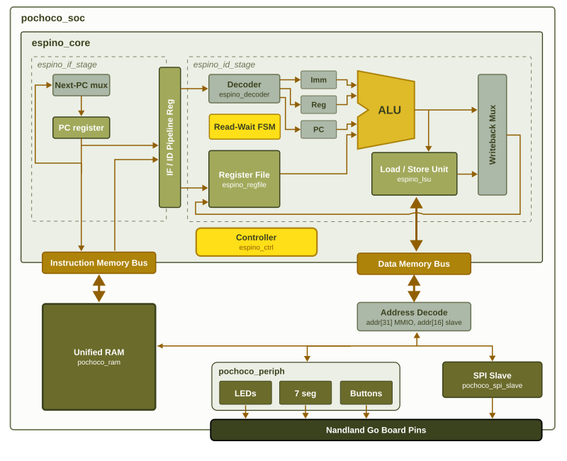

# Georgi - Quinteros - Riveros | Proyecto 3

**Arquitectura de Computadores**  
**Profesor:** Jorge Gómez

## Integrantes

- Christian Georgi
- Diego Quinteros
- Felipe Riveros

## Descripción del proyecto

Este proyecto consiste en la adaptación del procesador **Espino Core** y el sistema **Pochoco SoC** para su implementación como un circuito integrado de aplicación específica (**ASIC**) utilizando Verilog, LibreLane y la tecnología de fabricación **GF180MCU**.

Se mantiene el código de la implementación anterior en FPGA Nandland Go Board y se incorpora una versión para ASIC, con simulaciones, alternativas de memoria, síntesis lógica y diseño físico.

El procesador se basa en una arquitectura de 32 bits derivada de **RISC-V RV32E**, con banco de registros, unidad aritmético-lógica (ALU), unidad de carga y almacenamiento, control y periféricos mapeados en memoria.



## Arquitectura y periféricos

El sistema integra el procesador, la memoria de instrucciones, la memoria de datos y los periféricos de entrada y salida. Las direcciones principales utilizadas son:

| Dirección | Función |
|---|---|
| `0x0000_0000` | Espacio de memoria del programa y datos, según la arquitectura utilizada |
| `0x8000_0000` | Displays de 7 segmentos |
| `0x8000_0004` | LEDs |
| `0x8000_0008` | Botones |
| `0x8001_0000` | Registro de estado SPI |
| `0x8001_0004` | Dato recibido por SPI |
| `0x8001_0008` | Dato para transmisión SPI |

Para el ASIC se incluyen dos organizaciones de memoria: **ROM de instrucciones y RAM de datos separadas**, y una **memoria unificada**. Sus módulos y configuraciones se encuentran en `rtl/` y `librelane/`.

## Archivos principales

El proyecto está organizado en las siguientes carpetas y archivos:

- `rtl/asic_top.v`: módulo principal de la implementación ASIC.
- `rtl/game_top.v`: módulo principal de la implementación FPGA anterior.
- `rtl/pochoco_soc.v`: integración del procesador, memorias y periféricos.
- `rtl/pochoco_soc_unified.v`: alternativa del SoC con memoria unificada.
- `rtl/espino_core/`: procesador, ALU, decodificador, banco de registros y unidades de control.
- `rtl/pochoco_instruccion_rom.v` y `rtl/game_rom.v`: memoria de instrucciones y contenido del programa.
- `rtl/pochoco_data_ram.v`: RAM de datos para la alternativa de memorias separadas.
- `rtl/pochoco_unified_ram.v` y `rtl/pochoco_boot_loader.v`: memoria unificada y cargador.
- `rtl/pochoco_periph.v` y `rtl/pochoco_spi_slave.v`: periféricos y comunicación SPI.
- `sw/`: programas Assembly, ensamblador, archivos HEX y Makefile de software.
- `sim/`: testbenches RTL y gate-level.
- `librelane/`: configuraciones de síntesis, timing y diseño físico ASIC.
- `experimentos/`: pruebas de optimización y trazabilidad auxiliar de la ALU.
- `scripts/`: scripts para visualizar componentes en OpenROAD y preparar modelos de simulación.
- `Makefile` y `goboard.pcf`: herramientas y asignación de pines correspondientes a la FPGA anterior.

## Requisitos

Para reproducir el flujo **ASIC** se necesitan:

- Git y Python 3.
- Linux o Windows con WSL y una distribución Linux.
- Yosys.
- Icarus Verilog (`iverilog` y `vvp`).
- LibreLane (versión utilizada: **3.0.17**).
- OpenROAD.
- PDK **`gf180mcuD`**, con biblioteca `gf180mcu_fd_sc_mcu7t5v0`.
- GTKWave, opcional, para visualizar señales.

El proyecto se desarrolló con las herramientas disponibles dentro de un entorno **Nix shell** en WSL. Se puede utilizar otra instalación compatible. La instalación y habilitación del PDK deben realizarse según la documentación oficial de [LibreLane](https://librelane.readthedocs.io/).

Para utilizar además la implementación **FPGA** anterior se requieren GNU Make, `nextpnr-ice40`, `icepack`, `iceprog` y, para programarla físicamente, la Nandland Go Board y su conexión USB.

## Descargar el proyecto

Clonar el repositorio:

```bash
git clone https://github.com/ChrisG925/Proyecto3_Arquitectura_computadores.git
```

Ingresar a la carpeta:

```bash
cd Proyecto3_Arquitectura_computadores
```

**Importante:** salvo que se indique lo contrario, los comandos de las siguientes secciones deben ejecutarse desde esta carpeta, en una terminal con las herramientas instaladas y disponibles.

## Preparar el entorno para ASIC

Comprobar que los programas estén disponibles:

```bash
librelane --version
yosys -V
openroad -version
iverilog -V
python3 --version
```

Comprobar la variable que apunta al PDK:

```bash
echo "$PDK_ROOT"
```

Para visualizar la ALU se necesita que exista la ruta `$PDK_ROOT/gf180mcuD/libs.ref/gf180mcu_fd_sc_mcu7t5v0`. Si el PDK está instalado en otra carpeta, ajustar `PDK_ROOT` al directorio correspondiente.

## Generación del programa y las ROM

El juego está escrito en Assembly y utiliza el ensamblador propio `sw/assembler.py`.

Para generar los archivos HEX de los programas:

```bash
cd sw
python3 assembler.py game.s game.hex
python3 assembler.py game_sim.s game_sim.hex
cd ..
```

Los módulos Verilog `rtl/game_rom.v` y `rtl/game_sim_rom.v` se utilizan para la memoria de instrucciones. Si se modifica el programa, deben regenerarse también los módulos de ROM correspondientes mediante las opciones de generación disponibles en `sw/assembler.py`, para que el contenido Verilog y el programa coincidan.

## Simulación RTL

Se incluyen pruebas para una respuesta correcta y una incorrecta durante el juego.

Para compilar y ejecutar el caso de **respuesta correcta**:

```bash
mkdir -p sim/build

iverilog -g2012 -s tb_asic_correct -o sim/build/rtl_correct.vvp \
  sim/tb_asic_correct.v \
  rtl/asic_top.v rtl/pochoco_soc.v rtl/pochoco_periph.v \
  rtl/pochoco_spi_slave.v rtl/pochoco_instruccion_rom.v \
  rtl/pochoco_data_ram.v rtl/game_rom.v rtl/game_sim_rom.v \
  rtl/espino_core/*.v

vvp sim/build/rtl_correct.vvp
```

Para el caso de **respuesta incorrecta**:

```bash
iverilog -g2012 -s tb_asic_wrong -o sim/build/rtl_wrong.vvp \
  sim/tb_asic_wrong.v \
  rtl/asic_top.v rtl/pochoco_soc.v rtl/pochoco_periph.v \
  rtl/pochoco_spi_slave.v rtl/pochoco_instruccion_rom.v \
  rtl/pochoco_data_ram.v rtl/game_rom.v rtl/game_sim_rom.v \
  rtl/espino_core/*.v

vvp sim/build/rtl_wrong.vvp
```

Los resultados se muestran en la terminal. Si se genera un archivo de formas de onda `.vcd`, puede abrirse con:

```bash
gtkwave ruta/al/archivo.vcd
```

La carpeta `sim/` incluye pruebas adicionales para la memoria unificada, el cargador y otros componentes.

## Síntesis ASIC

La configuración principal del ASIC está en `librelane/config.json`. Para ejecutar la síntesis y detener el flujo después de Yosys:

```bash
librelane --pdk gf180mcuD \
  --run-tag sintesis_rom \
  --to Yosys.Synthesis \
  librelane/config.json
```

Para sintetizar la alternativa de **memoria unificada**:

```bash
librelane --pdk gf180mcuD \
  --run-tag sintesis_unified \
  --to Yosys.Synthesis \
  librelane/config_unified.json
```

Para conservar la jerarquía de módulos en la síntesis:

```bash
librelane --pdk gf180mcuD \
  --run-tag sintesis_hierarchy \
  --to Yosys.Synthesis \
  librelane/config_hierarchy.json
```

Los archivos generados se guardan dentro de `librelane/runs/<nombre-de-corrida>/`. La netlist de síntesis se encuentra en el directorio de la etapa `06-yosys-synthesis/`.

## Diseño físico del ASIC

Para ejecutar el flujo de implementación física de la arquitectura principal (ROM y RAM separadas):

```bash
librelane --pdk gf180mcuD \
  --run-tag fisico_rom_100ns_actualizado \
  librelane/config.json
```

Para la alternativa de memoria unificada:

```bash
librelane --pdk gf180mcuD \
  --run-tag fisico_unified_100ns \
  librelane/config_unified.json
```

LibreLane realiza las etapas configuradas de síntesis, floorplanning, colocación, enrutamiento y verificaciones disponibles. Las métricas, registros y archivos físicos de cada ejecución se encuentran en:

```text
librelane/runs/<nombre-de-corrida>/
librelane/runs/<nombre-de-corrida>/final/
```

Para la implementación principal, el archivo que se puede abrir con OpenROAD es:

```text
librelane/runs/fisico_rom_100ns_actualizado/final/odb/asic_top.odb
```

Si ya existe una corrida con el mismo nombre, utilizar otra etiqueta y adaptar las rutas de los scripts de visualización si es necesario.

## Pruebas de períodos de reloj y utilización

Para repetir las pruebas basta con ejecutar LibreLane indicando la configuración correspondiente. Por ejemplo, para **70 ns**:

```bash
librelane --pdk gf180mcuD \
  --run-tag prueba_rom_70ns \
  librelane/config_rom_70ns.json
```

Archivos disponibles:

| Prueba | Configuraciones |
|---|---|
| Período de reloj (ROM y RAM separadas) | `config_rom_50ns.json`, `config_rom_67ns.json`, `config_rom_69ns.json`, `config_rom_70ns.json` |
| Optimización RTL | `config_rom_70ns_optimizada.json` |
| Utilización objetivo del núcleo | `config.json` (40 %), `config_rom_util50.json` (50 %), `config_rom_util60.json` (60 %) |
| Memoria unificada | `config_unified.json`, `config_unified_50ns.json`, `config_unified_70ns.json` |
| Síntesis con jerarquía | `config_hierarchy.json`, `config_unified_hierarchy.json` |

Todas las configuraciones están dentro de `librelane/`. Los registros de timing y las métricas se generan en las carpetas de cada corrida.

## Simulación gate-level

Para verificar el funcionamiento utilizando la netlist sintetizada, primero generar la netlist correspondiente a la simulación:

```bash
librelane --pdk gf180mcuD \
  --run-tag sintesis_gate_sim \
  --to Yosys.Synthesis \
  librelane/config_gate_sim.json
```

La netlist se guarda en:

```text
librelane/runs/sintesis_gate_sim/06-yosys-synthesis/asic_top.nl.v
```

El script `scripts/generar_celdas_funcionales.py` sirve para preparar modelos funcionales de las celdas GF180MCU. Antes de utilizarlo, comprobar en el propio script qué ruta u opciones de entrada requiere y señalar la ubicación correspondiente a la instalación del PDK.

Una vez generado `sim/gf180_cells_functional.v`, ejecutar:

```bash
mkdir -p sim/build
NETLIST=librelane/runs/sintesis_gate_sim/06-yosys-synthesis/asic_top.nl.v

iverilog -g2012 -s tb_asic_gate_correct -o sim/build/gate_correct.vvp \
  sim/tb_asic_gate_correct.v "$NETLIST" sim/gf180_cells_functional.v
vvp sim/build/gate_correct.vvp

iverilog -g2012 -s tb_asic_gate_wrong -o sim/build/gate_wrong.vvp \
  sim/tb_asic_gate_wrong.v "$NETLIST" sim/gf180_cells_functional.v
vvp sim/build/gate_wrong.vvp
```

Los testbenches permiten repetir los casos de respuesta correcta e incorrecta con la netlist sintetizada.

## Visualización del diseño en OpenROAD

Los scripts de la carpeta `scripts/` permiten abrir el diseño y resaltar algunos componentes físicos.

Para visualizar el **banco de registros**:

```bash
openroad -gui -no_init scripts/resaltar_banco.tcl
```

Para visualizar el **contador de ciclos**:

```bash
openroad -gui -no_init scripts/resaltar_contador.tcl
```

Estos scripts utilizan las celdas identificadas en la corrida principal `fisico_rom_100ns_actualizado`. Si se genera una implementación diferente, los identificadores pueden cambiar.

### Visualización auxiliar de la ALU

Para identificar las celdas de la ALU se utiliza una síntesis jerárquica aplanada y un **placement auxiliar**, independiente del diseño físico final.

Ejecutar en este orden:

```bash
bash experimentos/alu_trazabilidad/generar_netlist.sh
openroad -no_init -exit experimentos/alu_trazabilidad/placement_alu.tcl
openroad -no_init -exit experimentos/alu_trazabilidad/verificar_alu.tcl
openroad -gui -no_init scripts/resaltar_alu.tcl
```

Se generan los archivos `asic_top_flat.v`, `asic_top_flat.json` y `asic_top_alu_placed.odb` en `experimentos/alu_trazabilidad/`. Este procedimiento permite visualizar las celdas de la ALU, pero **no corresponde al layout final enrutado del ASIC**.

## Implementación FPGA anterior

Se conservan los archivos del proyecto anterior, que utiliza la Nandland Go Board y la FPGA Lattice iCE40 HX1K.

Para compilar y programar la FPGA conectada:

```bash
make all
```

El `Makefile` principal utiliza `game_top` y `goboard.pcf`, y ejecuta Yosys, `nextpnr-ice40`, `icepack` e `iceprog`. Este comando intenta programar físicamente la placa, por lo que no debe utilizarse si no está conectada.

## Archivos generados y flujo completo

Los archivos de salida de simulación, síntesis y diseño físico se guardan localmente. La carpeta `librelane/runs/` y los archivos auxiliares de OpenROAD no forman parte necesariamente de los archivos versionados en GitHub.

Para reproducir el Proyecto 3 desde una instalación nueva:

1. Instalar las herramientas y habilitar el PDK GF180MCU.
2. Clonar el repositorio e ingresar a su carpeta.
3. Generar el programa y comprobar las ROM utilizadas.
4. Ejecutar las simulaciones RTL.
5. Ejecutar las síntesis de las arquitecturas de memoria.
6. Ejecutar los experimentos de timing y utilización.
7. Ejecutar el flujo físico del ASIC y consultar los archivos de salida.
8. Preparar los modelos de celdas y ejecutar las simulaciones gate-level.
9. Abrir los layouts en OpenROAD y visualizar el banco de registros, el contador y la ALU auxiliar.

Este README describe **cómo ejecutar y reproducir el proyecto**. El análisis de los resultados obtenidos se desarrolla por separado en el informe.
