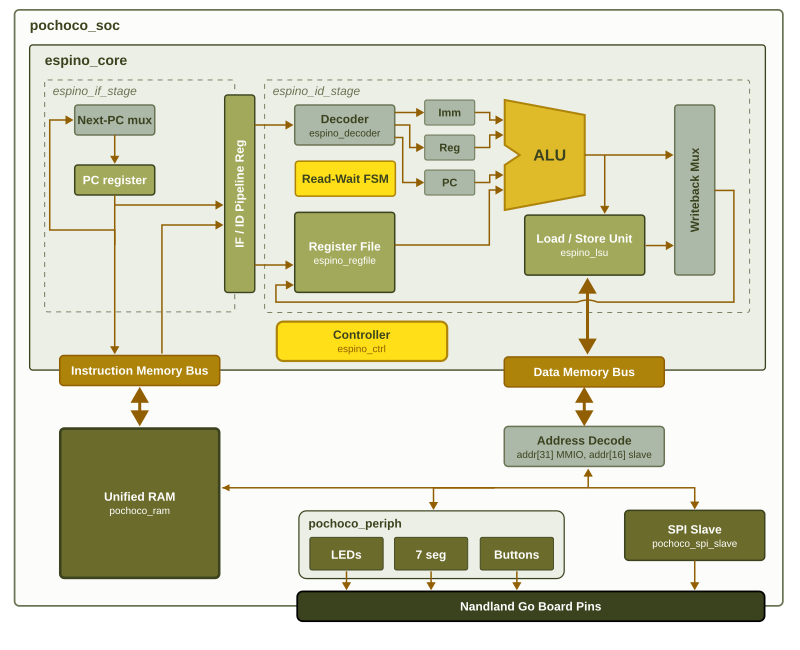

# Pochoco SoC & Espino Core

> Meet Pochoco SoC and Espino Core. Inspired by the native flora of the Pochoco trails, it is an entry-level, highly efficient architecture designed to flourish in resource-constrained environments.



Welcome to the repository! This project contains the RTL for a custom 32-bit processor and its surrounding System-on-Chip (SoC). The original FPGA implementation is preserved, alongside an ASIC implementation using the open-source GF180MCU design flow.

The design is intended for exploring computer architecture, digital verification, logic synthesis, and physical implementation.

## Repository Structure

The hardware is written in Verilog and divided into these main categories:

- **The Espino Core (`rtl/espino_core/`)**: RV32E processor with instruction fetch, decode, ALU, register file, load/store unit, and control logic.
- **The Pochoco SoC (`rtl/pochoco_soc.v`)**: Integrates the processor with memory-mapped peripherals and an SPI slave interface.
- **FPGA implementation (`rtl/game_top.v`, `Makefile`, `goboard.pcf`)**: Original FPGA top module, board pin constraints, synthesis, place-and-route, and programming flow. These files are intentionally retained.
- **ASIC implementation (`rtl/asic_top.v`)**: ASIC top-level module, including clock, reset, buttons, LEDs, seven-segment displays, and SPI pins.
- **Memory alternatives (`rtl/`, `librelane/`)**: Separate instruction ROM and data RAM, and an alternative unified-memory implementation with associated configurations.
- **Software (`sw/`)**: Assembly programs, custom assembler, Makefile, and instruction images.
- **Simulation (`sim/`)**: RTL and gate-level testbenches, including correct- and incorrect-button scenarios.
- **Physical design (`librelane/`)**: Configurations for synthesis, timing, utilization, and physical implementation using LibreLane.
- **Experiments (`experimentos/`)**: Alternative RAM implementation and auxiliary ALU placement workflow.
- **Visualization (`scripts/`)**: Scripts for displaying the register file, cycle counter, and ALU cells in OpenROAD.

## Memory Map

The SoC routes memory and data requests using an address-decoding scheme:

- **`0x0000_0000` — Main memory**: Instruction/data address space. The FPGA/unified-memory implementation and the ASIC ROM+RAM alternative use different internal memory organizations.
- **`0x8000_0000` — Board peripherals**:
  - Offset `0x00`: Seven-segment displays.
  - Offset `0x04`: LEDs.
  - Offset `0x08`: Button inputs.
- **`0x8001_0000` — SPI slave**:
  - Offset `0x00`: SPI status.
  - Offset `0x04`: Received byte.
  - Offset `0x08`: Byte written by the CPU for transmission.

Refer to the RTL for the actual memory depth, parameter values, and register behavior of each configuration.

## FPGA Implementation (Original Project)

The original FPGA files are retained for compatibility with the previous project. Install the Yosys/nextpnr/iCE40 toolchain (for example, [OSS CAD Suite](https://github.com/YosysHQ/oss-cad-suite-build)) and connect the supported iCE40 board before programming.

From the repository root:

```bash
make all
```

The root `Makefile` builds the bitstream for `game_top` and invokes `iceprog`. Do not run `make all` unless the target FPGA board is connected and you intend to program it.

## Generación de software y ROM

La carpeta `sw/` contiene los programas en ensamblador RV32E, el ensamblador propio (`sw/assembler.py`) y el `Makefile` original.

Para regenerar los archivos HEX del juego, ejecuta desde la raíz del repositorio:

```bash
cd sw
python3 assembler.py game.s game.hex
python3 assembler.py game_sim.s game_sim.hex
cd ..
```

El proyecto también incluye `rtl/game_rom.v` y `rtl/game_sim_rom.v`. Si modificas el programa en ensamblador, debes actualizar la ROM Verilog utilizada por el flujo correspondiente y comprobar que las instrucciones coincidan. Las opciones de generación están implementadas en `sw/assembler.py`.

Para compilar los ejemplos originales, utilizando una herramienta GNU RISC-V compatible:

```bash
cd sw
make blink
make 7seg
make buttons_leds
cd ..
```

El `Makefile` de `sw/` utiliza por defecto el prefijo `riscv64-unknown-elf-`, que puede cambiarse mediante `PREFIX=...`.

**Nota:** El procesador utiliza registros `x0` a `x15` (RV32E). Consulta `rtl/espino_core/espino_alu.v` antes de utilizar instrucciones de desplazamiento, ya que su comportamiento no es completo para todos los códigos de operación.

## Preparación del entorno ASIC

El diseño ASIC se trabajó en Linux/WSL con **LibreLane v3.0.17**, **GF180MCU (`gf180mcuD`)**, Yosys, OpenROAD, Icarus Verilog y Python 3, dentro de un entorno Nix. También puede utilizarse otra instalación compatible.

1. Instala WSL con Linux o utiliza directamente un entorno Linux.
2. Instala LibreLane, Yosys, OpenROAD, Icarus Verilog (`iverilog` y `vvp`) y Python 3. Para la instalación de LibreLane, consulta su [documentación oficial](https://librelane.readthedocs.io/).
3. Instala o habilita el PDK `gf180mcuD` y la biblioteca de celdas `gf180mcu_fd_sc_mcu7t5v0`.
4. Clona el repositorio, abre una terminal en su directorio raíz y comprueba las herramientas:

```bash
git clone https://github.com/ChrisG925/Proyecto3_Arquitectura_computadores.git
cd Proyecto3_Arquitectura_computadores

librelane --version
yosys -V
openroad -version
iverilog -V
python3 --version
echo "$PDK_ROOT"
```

Si `PDK_ROOT` está vacío, configúralo de acuerdo con la ubicación real del PDK. Los scripts de la ALU requieren que exista la carpeta `$PDK_ROOT/gf180mcuD/libs.ref/gf180mcu_fd_sc_mcu7t5v0`.

Salvo que se indique lo contrario, **todos los comandos siguientes se ejecutan desde la raíz del repositorio**, dentro del entorno donde estén disponibles las herramientas.

## Simulación RTL

Para ejecutar los casos de respuesta correcta e incorrecta con el diseño RTL:

```bash
mkdir -p sim/build

iverilog -g2012 -s tb_asic_correct -o sim/build/rtl_correct.vvp \
  sim/tb_asic_correct.v \
  rtl/asic_top.v rtl/pochoco_soc.v rtl/pochoco_periph.v \
  rtl/pochoco_spi_slave.v rtl/pochoco_instruccion_rom.v \
  rtl/pochoco_data_ram.v rtl/game_rom.v rtl/game_sim_rom.v \
  rtl/espino_core/*.v
vvp sim/build/rtl_correct.vvp

iverilog -g2012 -s tb_asic_wrong -o sim/build/rtl_wrong.vvp \
  sim/tb_asic_wrong.v \
  rtl/asic_top.v rtl/pochoco_soc.v rtl/pochoco_periph.v \
  rtl/pochoco_spi_slave.v rtl/pochoco_instruccion_rom.v \
  rtl/pochoco_data_ram.v rtl/game_rom.v rtl/game_sim_rom.v \
  rtl/espino_core/*.v
vvp sim/build/rtl_wrong.vvp
```

Los resultados se muestran en la terminal. Si un testbench genera un archivo `.vcd`, puede visualizarse con GTKWave. En `sim/` hay otros bancos de prueba para memorias, el cargador de arranque y el diseño unificado.

## Síntesis y diseño físico del ASIC

La implementación principal utiliza `asic_top`, un período de reloj de **100 ns** y una utilización objetivo del núcleo de **40 %**. Para ejecutar el flujo físico:

```bash
librelane --pdk gf180mcuD \
  --run-tag fisico_rom_100ns_actualizado \
  librelane/config.json
```

El nombre de la corrida se utiliza en los scripts de visualización del banco de registros y del contador. Si ya existe una corrida local con ese nombre, utiliza otra etiqueta y ajusta las rutas de esos scripts cuando corresponda.

LibreLane guarda las etapas, los registros de ejecución, las métricas y los archivos físicos en:

```text
librelane/runs/<nombre-de-corrida>/
librelane/runs/<nombre-de-corrida>/final/
```

Para la corrida principal, la base de datos de OpenROAD se encuentra en:

```text
librelane/runs/fisico_rom_100ns_actualizado/final/odb/asic_top.odb
```

Para ejecutar la alternativa con memoria unificada:

```bash
librelane --pdk gf180mcuD \
  --run-tag fisico_unified_100ns \
  librelane/config_unified.json
```

Para generar una síntesis que conserve la jerarquía de los módulos:

```bash
librelane --pdk gf180mcuD \
  --run-tag sintesis_hierarchy \
  --to Yosys.Synthesis \
  librelane/config_hierarchy.json
```

Los resultados de síntesis, timing, diseño físico y verificaciones están en los informes y archivos generados dentro de cada corrida. Algunas comprobaciones dependen de los recursos disponibles en la instalación del PDK; revisa los registros para identificar las verificaciones realmente ejecutadas.

## Experimentos de timing y utilización

Las configuraciones de `librelane/` permiten repetir las pruebas sin modificar los archivos RTL. Por ejemplo, para ejecutar la configuración de 70 ns:

```bash
librelane --pdk gf180mcuD \
  --run-tag prueba_rom_70ns \
  librelane/config_rom_70ns.json
```

Configuraciones disponibles:

- **Períodos de reloj con ROM y RAM separadas:** `config_rom_50ns.json`, `config_rom_67ns.json`, `config_rom_69ns.json` y `config_rom_70ns.json`.
- **Prueba de optimización RTL:** `config_rom_70ns_optimizada.json`.
- **Utilización objetivo:** `config.json` (40 %), `config_rom_util50.json` (50 %) y `config_rom_util60.json` (60 %).
- **Memoria unificada:** `config_unified.json`, `config_unified_50ns.json`, `config_unified_70ns.json` y `config_unified_hierarchy.json`.
- **Síntesis jerárquica:** `config_hierarchy.json`.

Cada corrida genera sus propios archivos e informes en `librelane/runs/`. Las comparaciones e interpretaciones se presentan en el informe del proyecto, no en este README.

## Simulación gate-level

Los bancos de prueba `sim/tb_asic_gate_correct.v` y `sim/tb_asic_gate_wrong.v` permiten verificar los casos de respuesta correcta e incorrecta con el netlist sintetizado.

Primero genera el netlist de la configuración de simulación:

```bash
librelane --pdk gf180mcuD \
  --run-tag sintesis_gate_sim \
  --to Yosys.Synthesis \
  librelane/config_gate_sim.json
```

El archivo Verilog resultante se espera en:

```text
librelane/runs/sintesis_gate_sim/06-yosys-synthesis/asic_top.nl.v
```

El script `scripts/generar_celdas_funcionales.py` genera modelos de las celdas GF180MCU compatibles con Icarus Verilog a partir de los modelos del PDK. Define `PDK_LIB` como la carpeta que contiene `gf180mcu_fd_sc_mcu7t5v0.v`:

```bash
export PDK_LIB="$PDK_ROOT/gf180mcuD/libs.ref/gf180mcu_fd_sc_mcu7t5v0/verilog"
python3 scripts/generar_celdas_funcionales.py
```

Si tu instalación utiliza otra estructura de directorios, ajusta `PDK_LIB` a la ubicación real de los modelos. Después ejecuta:

```bash
mkdir -p sim/build
NETLIST=librelane/runs/sintesis_gate_sim/06-yosys-synthesis/asic_top.nl.v

iverilog -g2012 -s tb_asic_gate_correct -o sim/build/gate_correct.vvp \
  sim/tb_asic_gate_correct.v "$NETLIST" sim/gf180_cells_functional.v
vvp sim/build/gate_correct.vvp

iverilog -g2012 -s tb_asic_gate_wrong -o sim/build/gate_wrong.vvp \
  sim/tb_asic_gate_wrong.v "$NETLIST" sim/gf180_cells_functional.v
vvp sim/build/gate_wrong.vvp
```

Si el netlist utiliza primitivas adicionales, incorpora los modelos Verilog correspondientes del PDK durante la compilación. Los resultados de ambos casos se muestran en la terminal y pueden contrastarse con la simulación RTL.

## Visualización en OpenROAD

Para abrir el **layout final del ASIC** y resaltar el banco de registros o el contador de ciclos, ejecuta uno de los siguientes comandos:

```bash
openroad -gui -no_init scripts/resaltar_banco.tcl
openroad -gui -no_init scripts/resaltar_contador.tcl
```

Cada comando abre una sesión independiente de OpenROAD. Estos scripts usan identificadores de celdas de la corrida `fisico_rom_100ns_actualizado`; si se vuelve a sintetizar el diseño, esos identificadores pueden cambiar.

### Visualización auxiliar de la ALU

La ALU se identifica mediante **una síntesis que conserva la jerarquía y un placement auxiliar independiente**. No corresponde a una identificación directa de las celdas de la ALU en el layout final optimizado.

Ejecuta desde la raíz del repositorio:

```bash
bash experimentos/alu_trazabilidad/generar_netlist.sh
openroad -no_init -exit experimentos/alu_trazabilidad/placement_alu.tcl
openroad -no_init -exit experimentos/alu_trazabilidad/verificar_alu.tcl
openroad -gui -no_init scripts/resaltar_alu.tcl
```

Este procedimiento genera `experimentos/alu_trazabilidad/asic_top_flat.v` y `asic_top_alu_placed.odb`. Sirve para identificar y visualizar las celdas asociadas a la ALU; **no es un layout final con routing y verificaciones de fabricación**. La cantidad exacta de celdas puede variar entre versiones de las herramientas o del PDK.

## Archivos generados

Las corridas de LibreLane, las formas de onda, los registros de ejecución, los netlists temporales y las bases de datos OpenROAD se generan localmente y no necesariamente están disponibles en GitHub.

Para obtenerlos, ejecuta los comandos de las secciones anteriores. Los archivos originales de FPGA, las configuraciones ASIC, los testbenches y los scripts de reproducción permanecen en el repositorio.
